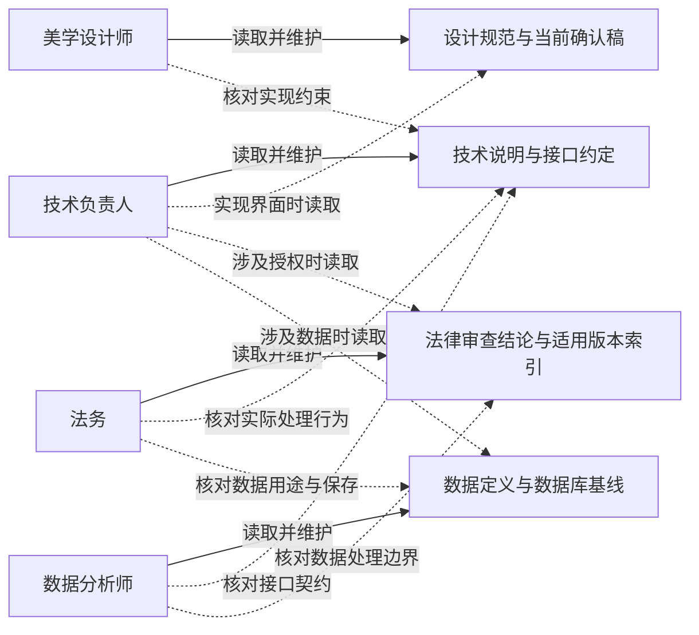
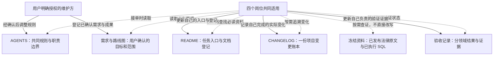
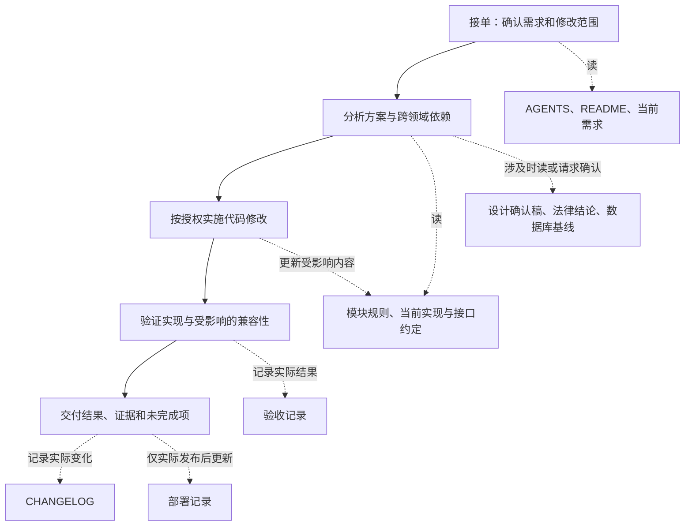
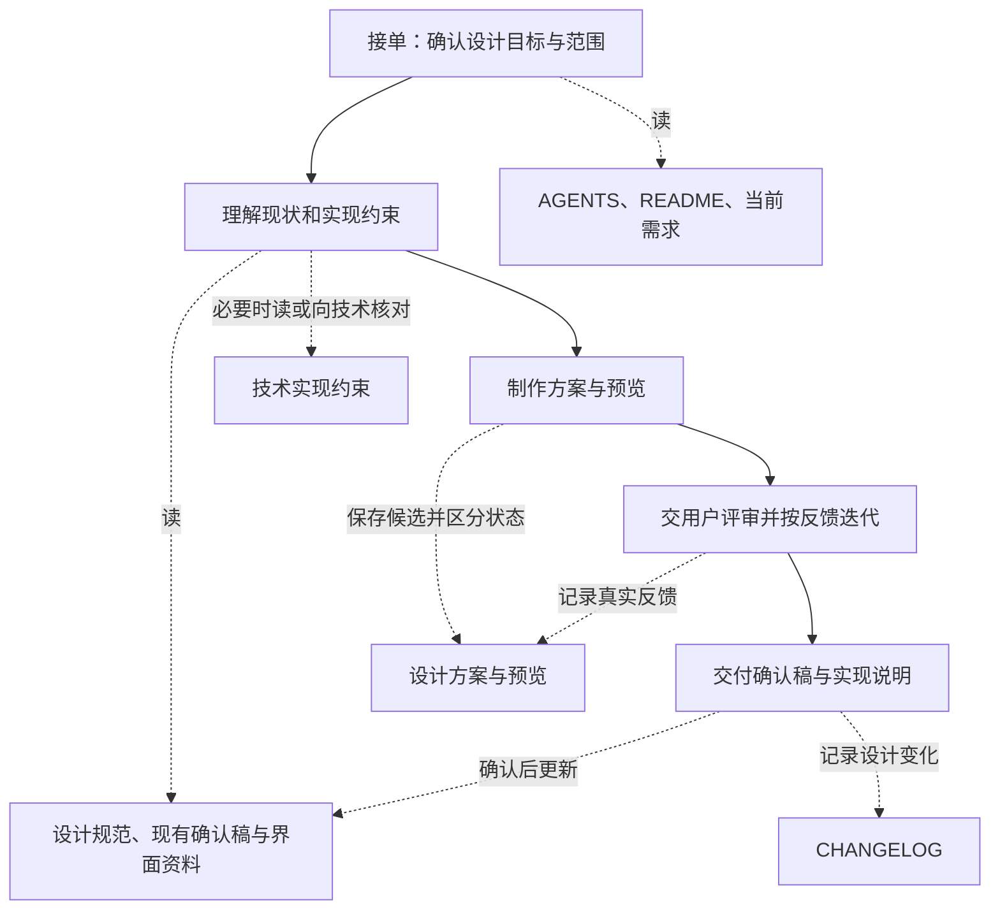
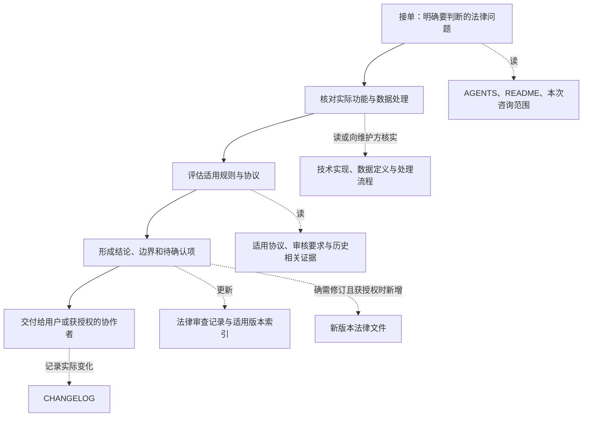
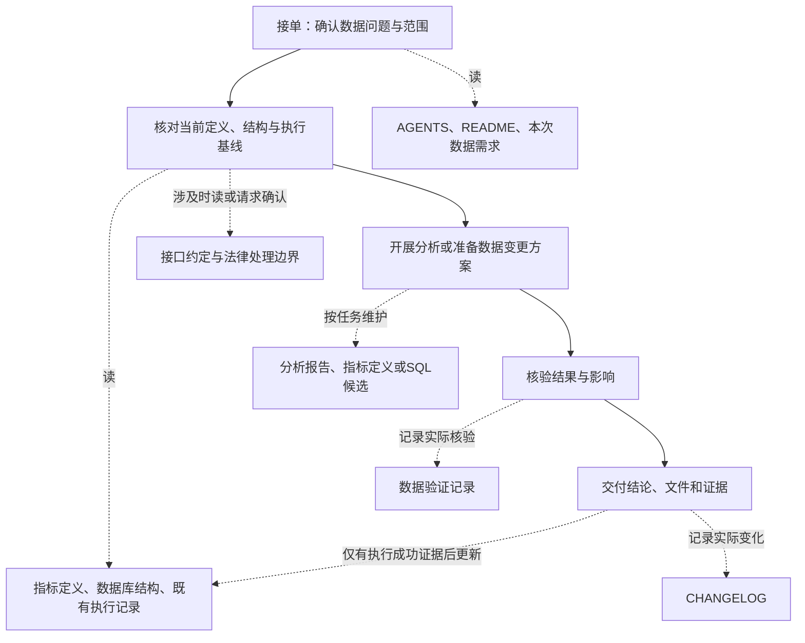

# codex-session-collaboration

**Codex 跨会话协作范式 · 第一版审阅草案**

给 Codex 里的多个 Session 建立一套团队工作方法，而不是给单个 Agent 规定执行流水线。

第一版针对技术负责人、美学设计师、法务、数据分析师四个岗位。用户保留方向、重大取舍及授权决定；不设常驻项目负责人，不追求任意规模的通用组织框架。

## 为什么做这个 Skill

这个 Skill 起源于实际项目协作中的一个问题：让 Codex 自发组织项目管理和跨 Session 沟通后，作者观察到 Token 消耗量达到过去的 **2—3 倍**。多个会话能够分工，不代表它们自然就会形成高效的协作方法。

重复传递背景、反复确认与回报、在多份文档中维护相同信息，都可能让协作本身变成额外负担。因此，我们希望把职责边界、信息维护和交接方式明确下来：让必要的信息准确传到需要它的 Session，减少无效沟通与重复读取，同时保留必要的专业核验和授权边界。

这就是 `codex-session-collaboration` 的出发点：不是让 Agent 做更多项目管理，而是让多个 Session 用更少的协作负担把项目推进下去。

> “2—3 倍”来自作者在自身项目中的使用观察，不是对 Codex 的普遍基准测试；上述消耗来源尚未做定量归因。本 Skill 的节省效果也尚未通过对照测试验证，不承诺固定的 Token 降幅。

## 它解决什么

会话各自记忆有限、专业分工不同：谁维护事实，何时需要沟通，交接提供什么，换会话怎样恢复，以及怎样避免一条结论在多个文件中变成不同答案。

消息负责传递任务，文档负责保留知识，证据负责确认状态。Skill 是方法约定，不是自动发消息的服务，不提供访问控制或文件锁，也不能让其他会话自动加载自身。

## 阅读顺序

| 文件 | 供谁阅读／用途 |
|---|---|
| [SKILL.md](SKILL.md) | Codex 使用的核心入口；建立、执行和恢复协作 |
| [岗位与权限](references/roles.md) | 定义四岗位、共享维护边界与任务牵头 |
| [沟通与交接](references/communication.md) | 何时联系、请求与交付的最小信息、分歧与恢复 |
| [知识与文档关系](references/project-map.md) | 事实归属、任务必读、防漏读与重复结论 |
| [项目适配模板](assets/project-collaboration-template.md) | 把方法映射到项目现有文件与实际会话；不是新建全部目录 |

## 岗位与文档的读写关系

这是本 Skill 建议项目采用的协作约定，不是系统自动执行的访问权限。具体分工以项目确认结果为准；完整边界以[岗位与权限](references/roles.md)为准。

**图例：虚线表示读取，实线表示维护／更新。箭头统一从岗位指向文档。维护仅限本次获授权范围，不代表有权发布或执行数据库操作。**

### 领域文档：各自维护，跨领域按需读取

虚线展示常见依赖，不是跨领域阅读的完整白名单，也不要求每次任务读全四个领域。读取他人文档后发现问题，可以提出修改请求，不能顺手改写对方的专业结论。

### 共同文档：所有岗位读取，按职责更新

**共同维护不是共同覆盖。** 修改前重读目标段落，保留其他人的增量；涉及同一区块时明确本轮写入方。冻结资料没有直接修改箭头：即使是该领域维护人，也必须按项目的新增版本／补充记录规则处理。

## 每个 Session 的工作过程与文档

以下按“接单 → 工作 → 核验 → 交付”展开。**实线箭头表示工作顺序；虚线连接步骤与文档，并标明读取或更新。** 文档名称代表项目中的事实源，不要求按名称新建文件。它们是常见任务示例，不是每次必须跑完的审批流水线；用户只要求讨论或诊断时，不进入实施步骤。

每个岗位接单时都先读 AGENTS 确认职责与授权，再从 README 直达本任务的必读资料。下面把共同入口合为一个文档节点，避免重复铺开。

### 技术负责人 Session

例如授权弹窗涉及法律含义时，先取得对应结论再实现；不能把代码完成写成已发布，也不替用户宣布真机验收通过。

### 美学设计师 Session

交给技术时传递确认稿位置、交互规则及未决项，而不是只说“做成这样”。设计通过不等于 App 已实现；未获确认的稿件仍保留候选状态。

### 法务 Session

既有冻结法律原文只读。新增协议、审查通过和公开发布分别记录，不能因为审查通过就更新成已上线。

### 数据分析师 Session

分析任务不必经过 SQL 执行；提供 SQL 也不等于数据库已变更。例如新增一项使用指标时，数据分析师维护指标定义与验证结果，技术按双方确认的数据契约实现采集；是否允许采集仍需核对适用授权与法律边界。

### 跨 Session 如何接上

四条流程通过“请求具体结论 → 返回事实源与证据”连接，不靠复制全部聊天历史。只有存在专业依赖且获得发送授权时才联系对应岗位；每个岗位继续维护自己的文档，交接消息链接过去。具体格式见[沟通与交接](references/communication.md)。

新增或迁移文档时，各岗位同步 README 的对应登记；没有文档结构变化，就不必每次重写入口。下一位 Session 通过入口读取更新后的事实源，而不是猜哪份聊天摘要最新。

## 如何使用

把整个目录作为一个 Skill 安装到 Codex 的技能目录，保留 `references` 和 `assets`。本仓库根目录就是 Skill 根目录；不能只复制 SKILL.md 而丢失引用资源。

可先在会话中提出：

> 使用 $codex-session-collaboration，检查本项目现有协作方式，按四个岗位提出适配方案。先讨论，不修改文件，也不联系其他会话。

或在已经建立约定的项目中提出：

> 使用 $codex-session-collaboration，整理这次授权弹窗调整需要法务与技术交接的信息。先给我看请求内容，尚未授权发送。

Skill 不会自动安装到其他设备，也不会自行创建角色会话、提交代码、发布服务或改数据库。

## 当前边界

- 当前是供用户审阅的方法草案，尚未完成真实多 Session 试运行。
- 不把原项目私有数据、生产配置或会话 ID 写进通用 Skill。
- 仓库公开用于审阅与讨论，不代表 Skill 已安装或完成实际协作验证。
- 开源许可证尚待作者选择；公开仓库不等于已授予开源使用许可，正式开源授权前需要补充 LICENSE。
